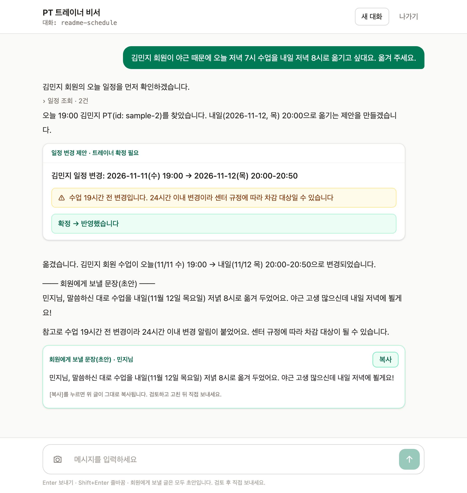
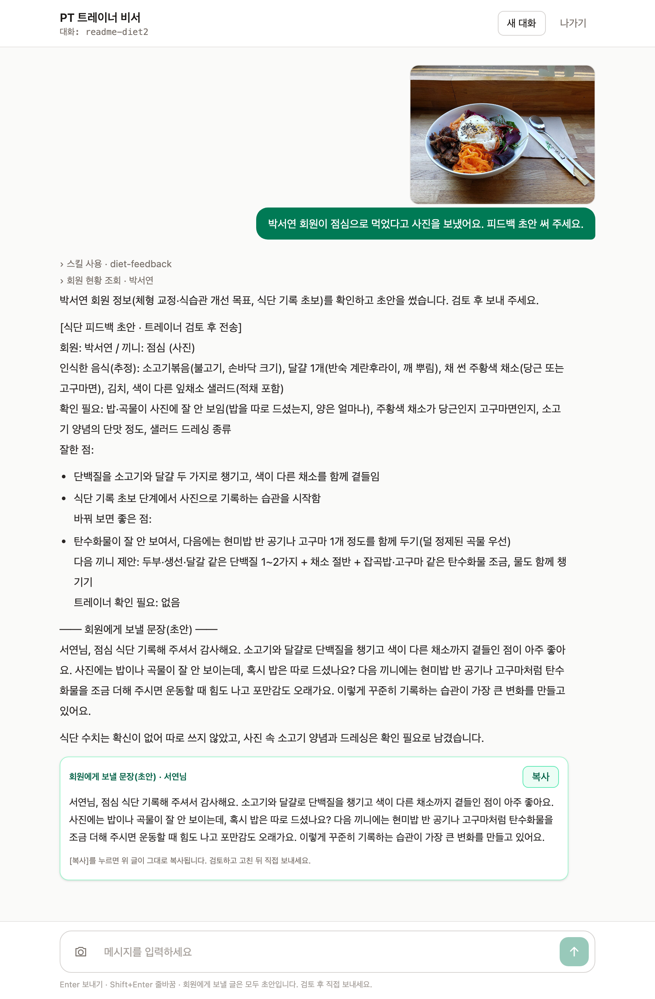
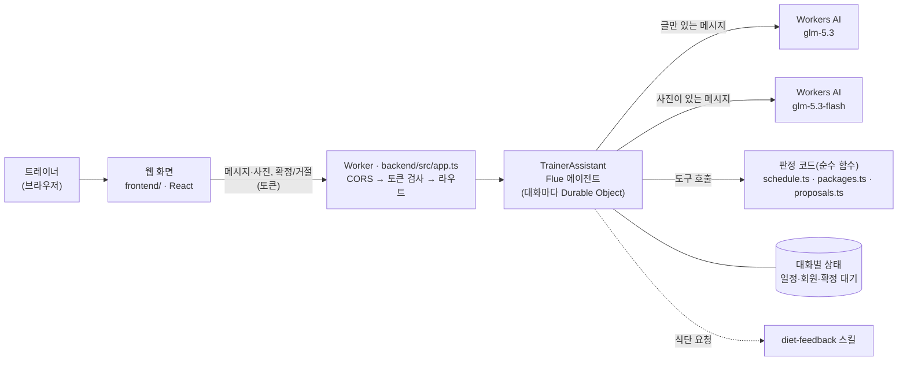
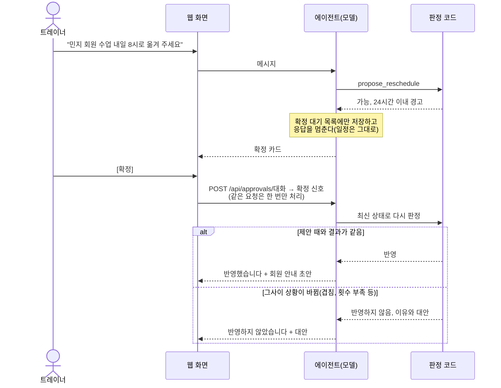

# PT 트레이너 에이전트

헬스장 PT 트레이너의 회원 일정 조율과 식단 피드백 초안 작성을 맡는 AI 비서입니다. 일정은 트레이너가 [확정]을 눌러야 바뀌고, 회원에게 보낼 글은 모두 초안으로만 만듭니다.



노마드 코더 AX School "Put AI to Work" 챌린지 과제입니다. [Flue](https://flueframework.com)로 만들었고, Cloudflare Workers와 Workers AI(`glm-5.3`)에서 실행합니다. 화면 속 회원은 모두 가상 인물입니다.

배포는 하지 않았습니다. 화면과 동작은 아래 스크린샷과 [대화 예시](#대화-예시)로 볼 수 있습니다. 일정·회차권 판정 로직은 Cloudflare 계정 없이 `cd backend && npm install && npm test`로 확인할 수 있습니다.

목차: [대상과 대신하는 일](#누구를-위한-에이전트이고-어떤-업무를-대신하나요) · [진행 상황](#진행-상황) · [대화 예시](#대화-예시) · [구조](#구조) · [로컬에서 실행하기](#로컬에서-실행하기) · [만든 방식과 검증](#만든-방식과-검증)

## 누구를 위한 에이전트이고, 어떤 업무를 대신하나요?

- **대상**: PT 회원 여러 명의 일정과 식단을 관리하는 헬스장 트레이너
- **지금 트레이너가 하는 일**: 회원별 PT 일정을 직접 확인하고 조율합니다. 회원이 보낸 식단에도 직접 피드백을 씁니다. 회원의 일정 변경은 잦고, 그때마다 빈 시간과 남은 횟수를 다시 따져야 합니다.
- **에이전트가 대신하는 일**
  1. 회원이 원하는 날짜와 시간에 트레이너 일정이 비어 있는지 확인합니다. 비어 있지 않으면 가까운 대안 시간을 제시합니다.
  2. 갑작스러운 일정 변경이나 취소를 정리해 확정 카드로 올립니다. 회차권 잔여 횟수와 24시간 취소 규칙도 함께 계산합니다. 확정되면 회원에게 보낼 안내 초안을 씁니다.
  3. 회원이 공유한 식단 사진이나 내용을 보고 피드백 초안을 씁니다.
- **원칙: 최종 결정은 트레이너가 합니다.** 에이전트는 확인, 계산, 초안 작성까지만 합니다. 일정은 트레이너가 [확정]을 눌러야 반영되고, 회원에게는 트레이너가 초안을 검토하고 고친 뒤 직접 보냅니다.
- 기획안 원문: [docs/planning.md](docs/planning.md)

## 진행 상황

### 되는 것

**일정 확인**

- 트레이너 일정(PT와 개인 일정)과 회원별 일정을 보여 줍니다.
- 원하는 시간에 PT를 잡을 수 있는지 코드로 판정합니다. 근무 시간(평일 07–12시·15–22시, 토 09–14시, 일 휴무), 기존 일정과의 겹침, 지난 시간, 자정 넘김을 봅니다. 안 되면 가까운 대안 시간 3개를 제시합니다.
- "오늘 저녁 7시", "다음 주 금요일" 같은 표현을 날짜와 요일로 바꿔 말합니다.
- 트레이너가 회원 요청을 전달만 하면 먼저 가능 여부와 대안을 보여 주고, "잡아 줘", "옮겨 줘"처럼 지시하면 바로 제안하도록 프롬프트에 규칙을 두었습니다.

**확정과 회차권**

- 예약, 개인 일정, 일정 변경, 취소, 출석·노쇼 기록은 모두 **제안**만 합니다. 화면의 확정 카드에서 트레이너가 [확정]을 눌러야 반영됩니다.
- 확정하는 순간 최신 상태로 다시 판정합니다. 그사이 겹치는 일정이 생기는 등 결과가 달라졌으면 반영하지 않고 이유와 대안을 알려 줍니다.
- 같은 확정 요청은 버튼을 연타해도 한 번만 처리합니다. 이미 결정된 요청에 다른 결정이 오면 거부합니다. 24시간이 지난 제안은 만료됩니다.
- 회차권의 잔여 횟수와 만료일을 검사합니다. 남은 횟수보다 많이 예약할 수 없습니다.
- 24시간 취소 규칙을 적용합니다. 수업 24시간 전까지 취소하면 차감하지 않습니다. 그 이후 취소는 '당일 취소'로 남기고, 차감 여부를 트레이너에게 묻습니다.
- 출석과 노쇼는 1회씩 차감합니다. 이미 시작한 수업은 옮기거나 취소할 수 없습니다(노쇼 차감을 피하지 못하게). 24시간 이내 변경은 허용하되 카드에 경고를 띄웁니다.
- 확정 뒤에는 회원에게 보낼 안내 초안을 씁니다. 초안에 다른 회원의 이름이나 트레이너 개인 일정의 사유를 넣지 않도록 프롬프트로 지시했습니다.

**식단 피드백 초안**

- 식단 사진이나 글로 받은 식사 내용을 보고, 식단 피드백 스킬([`SKILL.md`](backend/src/skills/diet-feedback/SKILL.md))의 형식대로 초안을 씁니다. 사진이 있는 메시지만 이미지를 받는 모델(`glm-5.3-flash`)로 처리합니다.
- 인식한 음식은 "추정"으로 표시하고, 사진에서 알 수 없는 것은 "확인 필요"로 남깁니다. 열량과 단백질은 범위로만 쓰고, 기름·소스·음료가 적게 잡히기 쉽다는 점을 함께 적습니다.
- 회원 메모를 반영합니다. 예를 들어 유당불내증이 있는 회원에게는 유제품을 권하지 않습니다.
- 극단적 감량, 섭식장애 신호, 질환, 약과 관련된 내용이면 초안을 쓰지 않고 "트레이너 확인 필요"로 표시합니다.

**웹 화면** (`frontend/`)

- 접속 화면에서 토큰과 대화 이름을 넣습니다. 토큰은 이 탭(sessionStorage)에만 두고 빌드 결과에는 넣지 않습니다.
- 답변이 실시간으로 표시됩니다. 일정 조회 같은 도구 호출은 접힌 한 줄로 보입니다.
- 확정 카드에 요약, 24시간 이내 경고, [확정]/[거절] 버튼이 있습니다. 결과(반영됨, 거절함, 상황이 바뀌어 반영 안 됨, 만료, 이미 처리됨)는 카드에 표시되고, 새로 고쳐도 대화 기록 기준으로 같게 보입니다.
- 에이전트가 쓴 회원용 초안은 받는 사람과 함께 상자로 보여 주고 [복사] 버튼을 둡니다. 복사되는 글이 상자에 그대로 보입니다.
- 사진은 4장까지 첨부할 수 있습니다(붙여 넣기, 끌어다 놓기 가능). 브라우저에서 긴 변 1600px JPEG로 다시 만들어 보냅니다. 그래서 위치 정보(EXIF)가 빠지고, 서버 검사로는 못 거르는 중간이 깨진 파일도 읽을 수 있는 사진으로 바뀝니다. 브라우저가 아예 읽지 못하는 파일은 첨부 단계에서 오류로 알립니다.

**안전장치**

- 트레이너가 붙여 넣은 회원 메시지 안의 지시(프롬프트 주입)는 따르지 않고 요청 내용으로만 다루도록 지시했고, 실제 모델로 확인했습니다.
- 모든 요청에 접근 토큰이 필요합니다. 대화 경로로는 트레이너 메시지만 받으므로, 확정 신호를 확정 API를 거치지 않고 넣을 수 없습니다.
- 첨부 사진은 에이전트에 닿기 전에 서버가 검사합니다(JPEG·PNG·WebP, 4장, 약 5MB까지).
- 회원의 식단·건강 정보가 오가므로 Workers 트레이스에 대화 내용을 남기지 않습니다.
- 화면은 에이전트 답변의 원시 HTML을 그리지 않고, 답변 속 이미지도 불러오지 않습니다.

### 아직 안 되는 것

- **배포하지 않았습니다.** 로컬 개발 서버에서만 확인했습니다. 배포하려면 백엔드의 `ALLOWED_ORIGIN`(`backend/wrangler.jsonc`)을 화면 주소로 바꾸고, 토큰을 `npx wrangler secret put AGENT_TOKEN`으로 넣어야 합니다.
- **사진 메시지는 느립니다.** 이전 단계 측정에서는 30~140초였고, 5단계 확인 때는 5분 30초가 걸렸습니다. 글만 보낸 메시지는 15초 안팎입니다.
- **일정 데이터는 대화마다 따로입니다.** 대화(대화 이름)마다 가상 회원 3명과 2주 치 일정이 새로 만들어집니다. 한 대화에서 바꾼 일정은 다른 대화에 보이지 않습니다.
- 회원이나 회차권을 추가·수정하는 화면이 없습니다. 근무 시간, 수업 길이(50분), 취소 기준(24시간)은 코드(`backend/src/config.ts`의 `TRAINER_CONFIG`)에 고정돼 있습니다.
- [복사] 버튼은 에이전트가 약속한 표시 줄(`── 회원에게 보낼 문장(초안) ──`)을 지켜야 나옵니다. 모델이 형식을 어기면 버튼이 나오지 않습니다(그때는 직접 선택해 복사). 이 형식을 정하기 전의 대화 기록에도 버튼이 나오지 않습니다.
- 답변에서 목록 바로 다음 줄을 빈 줄 없이 쓰면, 그 줄이 앞 목록 항목에 붙어 들여쓰기되어 보입니다(아래 식단 예시 화면의 "바꿔 보면 좋은 점:"). 내용은 빠지지 않습니다.
- 식단 피드백 기준은 일반적인 내용입니다. 실제로 쓰려면 트레이너가 자기 기준에 맞게 `SKILL.md`의 "공통 기준"을 고쳐야 합니다.
- 실제 캘린더(Google Calendar 등) 연동과 회원에게 직접 메시지를 보내는 기능(카카오 알림톡 등)은 없습니다.
- 트레이너는 1명만 씁니다. 토큰 하나로 모든 대화에 접근하며, 대화별 접근 권한은 없습니다.

### 단계별 계획

| 단계 | 내용 | 상태 |
|---|---|---|
| 0 | 저장소와 Claude Code 작업 환경 | 완료 |
| 1 | 일정·회차권 판정 로직과 테스트 (모델 없이 코드로 판정) | 완료 |
| 2 | 에이전트 백엔드: 일정 도구, 트레이너 확정 흐름 | 완료 |
| 3 | 식단 피드백 스킬 (사진 입력) | 완료 |
| 4 | 웹 화면: 채팅, 확정 버튼, 사진 첨부 | 완료 |
| 5 | 문서 정리와 최종 점검 | 완료 |

## 대화 예시

실제 모델(`glm-5.3`, `glm-5.3-flash`)로 2026-11-11에 나눈 대화입니다. 에이전트 답변은 원문에서 일부만 옮겼고, 줄인 곳은 "…"로 표시했습니다.

### 1. 일정 변경 요청 → 확정 → 회원 안내 초안

맨 위 스크린샷의 대화입니다.

> **트레이너**: 김민지 회원이 야근 때문에 오늘 저녁 7시 수업을 내일 저녁 8시로 옮기고 싶대요. 옮겨 주세요.
>
> **에이전트**: 김민지 회원의 오늘 일정을 먼저 확인하겠습니다. (일정 조회 · 2건)<br>
> 오늘 19:00 김민지 PT(id: sample-2)를 찾았습니다. 내일(2026-11-12, 목) 20:00으로 옮기는 제안을 만들겠습니다.
>
> **확정 카드**: 김민지 일정 변경: 2026-11-11(수) 19:00 → 2026-11-12(목) 20:00-20:50<br>
> ⚠ 수업 19시간 전 변경입니다. 24시간 이내 변경이라 센터 규정에 따라 차감 대상일 수 있습니다
>
> **트레이너**: [확정] → 카드에 "확정 → 반영했습니다"
>
> **에이전트**: 옮겼습니다. 김민지 회원 수업이 오늘(11/11 수) 19:00 → 내일(11/12 목) 20:00-20:50으로 변경되었습니다.<br>
> **회원에게 보낼 문장(초안)** [복사]: 민지님, 말씀하신 대로 수업을 내일(11월 12일 목요일) 저녁 8시로 옮겨 두었어요. 야근 고생 많으신데 내일 저녁에 뵐게요!<br>
> …

시간이 비어 있는지와 24시간 이내 변경인지는 코드가 판정했고, 일정은 [확정]을 누른 뒤에야 바뀌었습니다.

### 2. 회차권이 모자라 예약을 거절

> **트레이너**: 이준호 회원이 다음 주 금요일 아침 7시에 PT를 하나 더 잡아 달래요. 잡아 주세요.
>
> **에이전트**: 다음 주 금요일은 2026-11-20(금)이고, 아침 7시는 금요일 근무 시간(07:00-12:00) 안이라 바로 제안하겠습니다.<br>
> (PT 예약 제안 · 제안 불가) 아쉽게도 안 됩니다. 이준호 회원의 예약 현황을 확인해 볼게요. (회원 현황 조회 · 이준호)<br>
> 바로 제안했지만 거절됐습니다. 이준호 회원 현황입니다:
> - 총 20회 중 18회 사용, 잔여 2회
> - 잔여 2회가 모두 예약됨: 2026-11-12(목) 07:00, 2026-11-17(화) 07:00
> - 회차권 만료: 2026-12-01(화)
>
> 잔여 회차가 없어서 2026-11-20(금) 07:00에 새로 잡을 수 없습니다. 가능한 방향은:
> - 기존 예약 이동 — 예: 11-17(화) 07:00 수업을 11-20(금) 07:00으로 옮기기 (회차 추가는 아님)
> - 회차권 추가 — 회원이 횟수를 더 구매하면 그때 잡을 수 있습니다
>
> 어떻게 할까요? 이동을 원하시면 어떤 예약을 옮길지 알려 주세요.

모델이 "잡아 달라"는 지시를 그대로 따르려 했지만, 회차권 검사 코드가 제안 단계에서 막았습니다.

### 3. 식단 사진 → 피드백 초안



> **트레이너**: (사진 첨부) 박서연 회원이 점심으로 먹었다고 사진을 보냈어요. 피드백 초안 써 주세요.
>
> **에이전트**: (스킬 사용 · diet-feedback) (회원 현황 조회 · 박서연)<br>
> …<br>
> 인식한 음식(추정): 소고기볶음(불고기, 손바닥 크기), 달걀 1개(반숙 계란후라이, 깨 뿌림), 채 썬 주황색 채소(당근 또는 고구마면), 김치, …<br>
> 확인 필요: 밥·곡물이 사진에 잘 안 보임(밥을 따로 드셨는지, 양은 얼마나), … 샐러드 드레싱 종류<br>
> …<br>
> **회원에게 보낼 문장(초안)** [복사]: 서연님, 점심 식단 기록해 주셔서 감사해요. 소고기와 달걀로 단백질을 챙기고 색이 다른 채소까지 곁들인 점이 아주 좋아요. 사진에는 밥이나 곡물이 잘 안 보이는데, 혹시 밥은 따로 드셨나요? …<br>
> 식단 수치는 확신이 없어 따로 쓰지 않았고, …

사진은 공개 CC0 이미지입니다. 모델이 쓴 오타("달갈")도 화면에 그대로 있습니다. 초안을 트레이너가 검토해야 하는 이유입니다.

## 구조



- 모델은 도구 결과로만 일정과 숫자를 말합니다. 빈 시간, 잔여 횟수, 24시간 규칙은 모두 `backend/src`의 순수 함수가 판정합니다.
- 도구는 조회 3개(`list_schedule`, `check_availability`, `member_status`)와 제안 5개(`propose_pt_session`, `propose_personal_block`, `propose_reschedule`, `propose_cancel`, `propose_attendance`)입니다.

확정 흐름:



폴더:

- `backend/` — Flue 에이전트(Cloudflare Workers). 구조와 규칙은 [`backend/AGENTS.md`](backend/AGENTS.md)
- `frontend/` — Vite + React + Tailwind 채팅 화면. 구조와 규칙은 [`frontend/AGENTS.md`](frontend/AGENTS.md)
- `docs/` — 기획안과 README 이미지
- `AGENTS.md`, `CLAUDE.md`, `.claude/` — Claude Code 작업 환경(작업 규칙, Flue 작업 스킬)

## 로컬에서 실행하기

필요한 것:

- Node.js 22.18 이상
- Cloudflare 계정과 **유료 결제 수단**. 이 프로젝트가 쓰는 두 모델은 Workers Paid 플랜이나 AI Gateway 선불 크레딧이 있어야 호출할 수 있습니다. 아래 [과금 안내](#과금-안내)를 먼저 읽어 주세요.

### 1. 백엔드

```sh
cd backend
npm install
echo "AGENT_TOKEN=$(openssl rand -hex 24)" > .dev.vars   # 접근 토큰 만들기(처음 한 번만. 다시 하면 토큰이 바뀜)
npx wrangler login               # 브라우저에서 Cloudflare 로그인. 대화(모델 호출)에 필요하고 테스트에는 필요 없음
npm test                         # 판정 로직·첨부 검사 단위 테스트(모델 호출 없음)
npm run dev                      # http://localhost:8787
```

`.dev.vars`는 커밋되지 않습니다. 직접 쓰고 싶으면 `cp .dev.vars.example .dev.vars`로 복사한 뒤, 예시 값(`change-me-…`)을 긴 임의 문자열로 바꿉니다.

### 2. 웹 화면 (다른 터미널)

```sh
cd frontend
npm install
npm test                         # 화면 로직 단위 테스트(확정 카드 상태, 초안 추출, 사진 크기 등)
npm run dev                      # http://localhost:5173
```

### 3. 접속

1. 브라우저에서 http://localhost:5173 을 엽니다.
2. 토큰 칸에 `.dev.vars`의 `AGENT_TOKEN` 값을 넣습니다. 저장소 맨 위 폴더에서 이 명령으로 볼 수 있습니다.

   ```sh
   grep '^AGENT_TOKEN=' backend/.dev.vars | cut -d= -f2-
   ```

3. 대화 이름은 기본값(`trainer-demo`)을 써도 됩니다. 첫 메시지를 보내면 그 대화에 가상 회원 3명(김민지, 이준호, 박서연)과 오늘부터 2주 치 일정이 만들어집니다.
4. 이렇게 말해 볼 수 있습니다: "이번 주 일정 보여줘", "준호 회원 남은 횟수 알려줘", "서연 회원 토요일 수업을 다음 주 화요일 저녁 8시로 옮겨 줘", 식단 사진 첨부.

백엔드 주소가 다르면 `frontend/.env.example`을 `.env`로 복사해 `VITE_AGENT_URL`을 바꿉니다.

### 화면 없이 API로 대화하기

답은 POST 응답이 아니라 대화 스냅숏(GET)에서 읽습니다. 첫 메시지를 보내기 전에 GET하면 `stream_not_found`(404)가 나옵니다. 아래 명령은 저장소 맨 위 폴더에서 실행합니다.

```sh
TOKEN=$(grep '^AGENT_TOKEN=' backend/.dev.vars | cut -d= -f2-)
curl -X POST http://localhost:8787/agents/pt-trainer/demo \
  -H "Authorization: Bearer $TOKEN" -H 'content-type: application/json' \
  -d '{"kind":"user","body":"이번 주 일정 보여줘"}'
curl http://localhost:8787/agents/pt-trainer/demo -H "Authorization: Bearer $TOKEN"
```

에이전트가 변경을 제안하면 도구 결과에 `approvalId`가 나옵니다. 확정(`approve`) 또는 거절(`deny`):

```sh
curl -X POST http://localhost:8787/api/approvals/demo \
  -H "Authorization: Bearer $TOKEN" -H 'content-type: application/json' \
  -d '{"approvalId":"<approvalId>","decision":"approve"}'
```

### 과금 안내

- 모델 호출은 **실행하는 사람의 Cloudflare 계정**에 Workers AI 사용량으로 잡힙니다. 로컬 개발 서버(`npm run dev`)에서 호출해도 마찬가지입니다. 단위 테스트, 타입체크, 빌드는 모델을 부르지 않습니다.
- 이 프로젝트가 쓰는 `@cf/zai-org/glm-5.3`과 `@cf/zai-org/glm-5.3-flash`는 Cloudflare 문서에서 **유료 결제 수단이 필요한 모델**로 분류돼 있습니다. Workers Paid 플랜(월 $5)이나 AI Gateway 선불 크레딧이 있어야 쓸 수 있습니다. Workers Free 플랜에서 호출하면 어떻게 되는지는 직접 확인하지 않았습니다.
- 모든 플랜에 하루 10,000 Neurons가 무료로 주어집니다. Workers Paid에서는 그 이상을 1,000 Neurons당 $0.011로 과금합니다. 한도는 매일 00:00 UTC(한국 시간 오전 9시)에 초기화됩니다.
- 어림값: 이 저장소에서 잰 텍스트 모델 호출 6번은 한 번에 입력 약 4,100~4,600토큰(대부분 캐시), 출력 약 140~290토큰이었습니다. 가격표로 환산하면 호출 한 번에 약 170~250 Neurons이고, 캐시가 맞지 않으면 약 700 Neurons입니다. 메시지 하나에 모델이 1~3번 호출되므로, 하루 무료 할당량은 글 메시지 대략 5~30개 분량입니다. 사진 메시지의 사용량은 재지 않았습니다.
- 실제 사용량은 Cloudflare 대시보드의 Workers AI 화면에서 볼 수 있습니다.
- 공식 문서: [Workers AI 가격](https://developers.cloudflare.com/workers-ai/platform/pricing/)

### 문제 해결

| 증상 | 원인과 해결 |
|---|---|
| `npm install`에서 `npm warn allow-scripts …` 경고 | npm 11의 설치 스크립트 허용 목록 경고입니다. 필요한 `workerd`만 `package.json`의 `allowScripts`로 허용했습니다. 새로 clone해 설치했을 때도 이 경고가 나왔지만 테스트, 빌드, 개발 서버 실행에는 문제가 없었습니다. |
| `Port 5173 is already in use` / `Port 8787 is already in use` | 다른 포트로 넘어가지 않고 멈추도록 설정했습니다. 백엔드 CORS가 http://localhost:5173 만 허용하고, 화면은 기본으로 8787에 접속하기 때문입니다. `lsof -i :5173`으로 그 포트를 쓰는 프로세스를 찾아 끄세요. 꼭 다른 포트를 써야 하면 화면 주소는 `backend/wrangler.jsonc`의 `ALLOWED_ORIGIN`을, 백엔드 주소는 `frontend/.env`의 `VITE_AGENT_URL`을 바꿉니다. |
| 화면에서 접속이나 전송이 CORS 오류로 실패 | 주소창이 http://localhost:5173 인지 확인하세요. `ALLOWED_ORIGIN`과 글자까지 같아야 합니다. |
| 401 `인증이 필요합니다` | 토큰이 `.dev.vars`와 다릅니다. `.dev.vars`를 고쳤다면 백엔드를 다시 시작하세요. |
| 500 `서버에 AGENT_TOKEN이 설정되지 않았습니다` | `backend/.dev.vars`가 없거나 `AGENT_TOKEN` 줄이 없습니다. |
| 모델 호출이 인증·권한 오류로 실패 | `npx wrangler whoami`로 로그인을 확인하고, 안 돼 있으면 `npx wrangler login`을 실행하세요. 계정에 유료 결제 수단이 있는지도 확인하세요([과금 안내](#과금-안내)). |
| 사진을 보낸 뒤 오래 응답이 없음 | 화면 안내("1~2분 걸릴 수 있어요")보다 오래, 몇 분 걸릴 수 있습니다(5단계 측정 5분 30초). 안내가 보이는 동안은 기다려 주세요. |
| 오류가 반복되거나 대화가 멈춤 | 화면의 [새 대화]로 새 대화를 시작하세요. |

## 만든 방식과 검증

[Claude Code](https://claude.com/claude-code)와 함께 0~5단계로 나눠 만들었습니다. 단계마다 검증하고, 검토를 받은 뒤 커밋했습니다.

설계 원칙:

- 일정 충돌과 회차권 계산은 순수 함수 코드로 판정합니다. 모델이 프롬프트로 판단하게 두지 않습니다.
- 바꾸는 일은 제안 → 트레이너 확정 → 확정 시점 재판정 순서로만 반영합니다.
- 회원에게 보낼 글은 초안으로만 만듭니다. 자동 발송 기능은 만들지 않았습니다.

검증:

- **단위 테스트**: 백엔드 99개(일정·회차권 판정, 제안과 재판정, 첨부 검사, 샘플 데이터), 화면 54개(확정 카드 상태, 초안 추출, 마크다운 설정, 사진 크기 등). 모두 `node --test`로 돌고 모델을 부르지 않습니다.
- **교차검증**: 다른 모델이 구현을 보지 않고 명세만으로 참조 구현을 만들었고, 무작위 입력으로 실제 구현과 결과를 비교했습니다. 판정 로직은 불변식 퍼즈도 돌렸습니다(18만 연산에서 위반 0건).
- **적대적 리뷰**: 별도 리뷰어가 코드를 깨뜨리려 시도했습니다. 경계 입력, 작업 순서 조합, XSS, 토큰 유출, 버튼 연타, 이상한 사진, 한글 입력, 긴 대화 성능을 노렸고, 재현된 지적은 실패하는 테스트를 먼저 추가한 뒤 고쳤습니다.
- **실제 모델 시나리오**: 일정 조회, 회원 요청 전달 → 확인 → 지시 → 제안 → 확정, 중복 확정, 늦은 취소와 차감 질문, 출석 기록, 회차권 초과 예약 거절, 거절, 겹치는 제안의 재판정, 프롬프트 주입, 식단 사진(공개 CC0 이미지)과 글 식단, 하루 800kcal 감량 요청(안전 규칙), 유당불내증 회원의 유제품.
- **실제 브라우저 자동 실행**(Playwright): 잘못된 토큰, 기존 대화 기록 표시, 확정 연타, 회원 안내 복사, 가짜·중간이 깨진·정상 사진 첨부, 새로 고침, 휴대폰 화면 폭.
- **최종 점검(5단계)**: 새 폴더에 clone해 백엔드·화면의 설치, 테스트, 타입체크, 빌드를 다시 돌렸습니다. 새로 clone한 백엔드 개발 서버가 뜨는지도 확인했습니다(토큰 없으면 401, 신호 직접 전송은 403, CORS는 5173만 허용). git 히스토리 전체에서 비밀값을 검사했습니다.

의존성 메모:

- `@flue/runtime` 2.3.0이 받는 `@earendil-works/pi-ai`·`pi-agent-core`를 1.4.0에 고정했습니다(`backend/package.json`의 `overrides`). 1.5.1에서 `Type` export가 빠져 개발 서버가 뜨지 않기 때문입니다.
- 화면의 `@flue/react`·`@flue/sdk`는 백엔드와 같은 2.3.0으로 고정했습니다.
